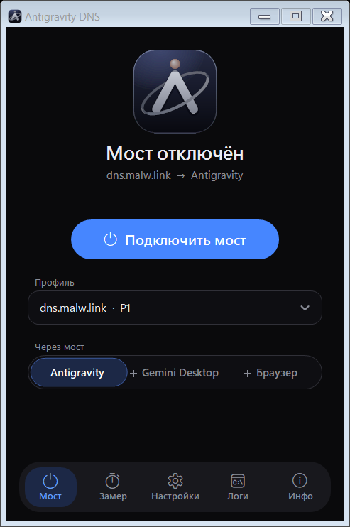
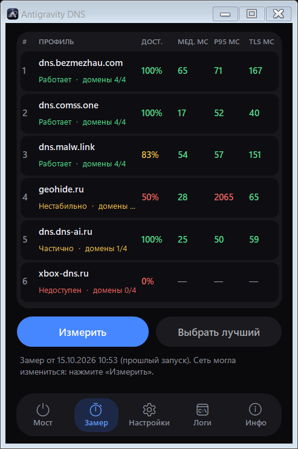

🇷🇺 Русский • [🇬🇧 English](docs/EN/README.md)

# Antigravity DNS

**DNS-мост для Antigravity, Gemini Desktop и сервисов Google в Windows.**

[](#установка)
[](#сборка-из-исходников)
[](LICENSE)
[](https://github.com/narechiyaprincess/Antigravity-DNS/releases/latest)

Приложение проверяет DoH-провайдеров, помогает выбрать рабочий и направляет DNS-запросы выбранных доменов через него. Провайдер возвращает адрес своего SNI-прокси; Windows применяет настройки через правила NRPT и регистрацию DNS over HTTPS. Один EXE, русский и английский интерфейс.

[Скачать выпуск](https://github.com/narechiyaprincess/Antigravity-DNS/releases) · [Сообщить о проблеме](https://github.com/narechiyaprincess/Antigravity-DNS/issues/new/choose) · [Сборка и проверки](docs/BUILDING.md)

<p>
  
  
</p>

*Снимки из тестового режима интерфейса. Значения замера иллюстративные; доступность нужно проверить в своей сети.*

## Возможности

- Шесть встроенных профилей; проверка закреплённых IP и поиск новых адресов провайдера при необходимости.
- Замер доступности, стабильности ответов, медианы и P95 DoH-запросов, времени TLS-подключения. Проверка TLS также для полученных адресов сервисов.
- Ранжирование результатов и кнопка **«Выбрать лучший»**. Она выбирает профиль; подключение выполняется отдельно.
- Три области: Antigravity, **«+ Gemini Desktop»**, **«+ Браузер»**.
- Свой DoH-провайдер: HTTPS-ссылка с именем хоста, необязательные IP и название.
- Проверка состояния моста, восстановление собственных записей, предложение другого профиля при сбое с подтверждением пользователя.
- Трей, уведомления, автозапуск при входе, история замеров и операций, логи и предпросмотр отчёта для поддержки.

## Сервисы и область действия

| Режим | DNS-имена |
|---|---|
| Antigravity | `daily-cloudcode-pa.googleapis.com`, `generativelanguage.googleapis.com` |
| + Gemini Desktop | Базовые имена и `gemini.google.com`, `geminiweb-pa.clients6.google.com` |
| + Браузер | Имена Antigravity/Gemini и суффиксы `.google.com`, `.googleapis.com`, `.gstatic.com`, `.googleusercontent.com`, `.google` |

Суффиксы расширяют действие правил на соответствующие имена Google. Замер проверяет конкретные домены Antigravity/Gemini, а не каждый сервис под этими суффиксами. Другие приложения могут использовать мост, если обращаются к этим именам через системный DNS Windows.

В каталоге есть `dns.malw.link`, `xbox-dns.ru`, `dns.comss.one`, `geohide.ru`, `dns.dns-ai.ru`, `dns.bezmezhau.com`. `xbox-dns.ru` и `dns.dns-ai.ru` помечены как экспериментальные. Состав и пояснения — в [profiles.json](src/app/profiles.json); датированные заметки являются историей проверок, а не обещанием текущей доступности.

## Как это работает

1. Приложение проверяет ответы DoH и TLS, при необходимости ищет адреса провайдера. Замер выполняется до изменения DNS-политики.
2. При подключении пользователь подтверждает доверие провайдеру и запрос UAC. Движок повторяет проверку, добавляет NRPT для выбранных имён и регистрирует DoH в Windows с отключённым UDP fallback.
3. Приложения, использующие системный DNS, получают ответы через эти правила. HTTPS-соединение к сервису проходит через инфраструктуру выбранного провайдера с сохранением проверки сертификатов.
4. При отключении движок удаляет подтверждённые собственные записи по журналу. Общие или изменённые извне записи могут быть сохранены; результат показывается в интерфейсе.

Движок изменяет системную DNS-политику для выбранных доменов. Он не туннелирует весь трафик, не переписывает DNS адаптеров, `hosts` или системный прокси и не настраивает VPN.

## Установка

- **Windows 11 x64** с доступными командами NRPT и системного DoH, Windows PowerShell 5.1, права администратора для подключения и восстановления.
- .NET отдельно устанавливать не нужно: runtime включён в EXE.
- Для Windows 10 совместимость не подтверждена; наличие .NET само по себе не означает поддержку системного DoH. См. [требования Microsoft к DoH](https://learn.microsoft.com/en-us/windows-server/networking/dns/doh-client-support) и [поддерживаемые ОС .NET 10](https://github.com/dotnet/core/blob/main/release-notes/10.0/supported-os.md).

1. Откройте [Releases](https://github.com/narechiyaprincess/Antigravity-DNS/releases) и скачайте `Antigravity-DNS-v1.0.0-win-x64.exe` и `SHA256SUMS.txt`, когда выпуск будет опубликован. Если выпусков ещё нет, используйте сборку из исходников.
2. Сверьте SHA-256 с суммой в выпуске:

   ```powershell
   Get-FileHash .\Antigravity-DNS-v1.0.0-win-x64.exe -Algorithm SHA256
   ```

3. Сохраните EXE в постоянную папку и запустите. Установщик и соседние файлы не требуются. Файл пока не подписан Authenticode; Windows может показать предупреждение о неизвестном издателе. Проверяйте источник и контрольную сумму.

## Использование

1. Откройте **«Замер» → «Измерить»**. Дождитесь результатов и нажмите **«Выбрать лучший»** либо выберите профиль вручную.
2. На вкладке **«Мост»** выберите область. По умолчанию достаточно **Antigravity**; Gemini и браузер добавляйте по необходимости.
3. Нажмите **«Подключить мост»**, прочитайте сведения о доверии провайдеру и подтвердите UAC.
4. Проверьте вход и нужное действие в самом Antigravity/Gemini. Успешная DNS-проверка не подтверждает доступность аккаунта или ответ модели.
5. Для возврата используйте **«Отключить мост»** / **«Восстановить»**. Закрытие окна может оставлять программу в трее; **«Выход»** завершает процесс и не заменяет отключение моста.

Автозапуск включается в **«Настройках»** и запускает интерфейс при входе в Windows. Это не служба и не автоматическое подтверждение UAC. При включённом автозапуске не переносите EXE без обновления настройки.

### Antigravity

Мост настраивает DNS для указанных API-доменов. Он не меняет файлы Antigravity и не проверяет ограничения учётной записи. Во вкладке **«Инфо»** есть ссылка на независимый [Open Antigravity Patcher](https://sourceforge.net/projects/open-antigravity-patcher/). Патчер не включён в EXE и автоматически не запускается; его совместимость и действия проверяются отдельно.

### Gemini Desktop и Google в браузере

**«+ Gemini Desktop»** добавляет два домена Gemini. **«+ Браузер»** расширяет область на суффиксы Google и предлагает диагностику выбранного браузера. Собственный Secure DNS/DoH браузера, VPN или TUN могут обходить системный резолвер. Приложение показывает рекомендации, но не переписывает настройки браузера. Изменение DNS не гарантирует снятие региональных или аккаунтных ограничений.

### Свой DoH

Откройте **«Настройки» → «Свой DoH-провайдер»**, укажите URL вида `https://dns.example/dns-query` и при необходимости IP-адреса. Хост в URL должен быть именем, не IP. Поиск адресов и проверка TLS/DoH выполняются тем же механизмом; сохранение профиля само по себе не подтверждает его пригодность для выбранных сервисов.

## Безопасность и данные

- Выбранный сторонний провайдер обрабатывает DNS-запросы и предоставляет SNI-прокси. Проверка TLS не является аудитом его инфраструктуры или политики хранения данных.
- Проверяются имя и цепочка сертификата; явный отзыв отклоняется. Недоступность сервера проверки отзыва обрабатывается как soft-fail. Приложение не устанавливает корневые сертификаты.
- Движок проверяет DoH-запрос напрямую и ответы системного резолвера, но **не подтверждает шифрование системного DNS захватом сетевых пакетов**.
- Настройки, история и ошибки интерфейса: `%LocalAppData%\AntigravityDnsUnlocker`. Журнал изменений и подготовленные PowerShell-ресурсы: `%ProgramData%\AntigravityDnsUnlocker`. Удаление EXE не очищает эти данные и не отключает правила.
- Отчёт поддержки имеет предпросмотр и автоматическое скрытие персональных данных. Перед публикацией просмотрите его; не прикладывайте сырые `settings.json`, журналы, токены или приватные DoH-ссылки.

## Если что-то не работает

| Симптом | Что проверить |
|---|---|
| Ни один профиль не работает | Повторите замер в своей сети; изучите TLS/DoH-ошибки в «Логах». Не отключайте проверку сертификатов. |
| Мост подключён, сервис недоступен | Проверьте область, собственный DNS приложения/браузера, VPN/TUN и ограничения аккаунта. |
| `DOH_UNSUPPORTED_BY_OS` | Убедитесь, что Windows предоставляет команды системного DoH; обновите ОС. |
| Конфликт NRPT/DoH или изменения правил | Откройте «Подробнее» и диагностику. Не удаляйте чужие правила вслепую. |
| WMI не отвечает / операция не подтверждена | Дождитесь завершения, посмотрите диагностику; используйте предложенное восстановление. Не удаляйте журнал вручную. |
| Нужен баг-репорт | Создайте отчёт на вкладке «Логи», проверьте предпросмотр и заполните [форму issue](https://github.com/narechiyaprincess/Antigravity-DNS/issues/new/choose). |

## Сборка из исходников

Windows x64, [.NET SDK 10](https://dotnet.microsoft.com/en-us/download/dotnet/10.0), Windows PowerShell 5.1. Команды из корня репозитория:

```powershell
powershell.exe -NoProfile -ExecutionPolicy Bypass -File .\src\app\Build.ps1
& .\src\.work\build\AntigravityDnsUnlocker.exe --self-test
& .\src\.work\build\AntigravityDnsUnlocker.exe --verify-scripts
```

Проверка текущего приложения, включая offline E2E ярусов 5–14, UI и запуск одиночного EXE:

```powershell
powershell.exe -NoProfile -ExecutionPolicy Bypass -File .\src\tools\verify.ps1 -Tag local -NoPublish
```

Выходные файлы и логи остаются в игнорируемой `src/.work/`. `-NoPublish` отключает замену локального выпуска и ярлыка. Исторические ярусы 1–4 требуют отдельных legacy fixtures; они не входят в этот режим. Подробности, собственный путь SDK и ограничение WinForms trimming — в [BUILDING.md](docs/BUILDING.md).

## Архитектура и структура

GUI и сетевые проверки написаны на C# WinForms. `Engine.ps1` применяет и восстанавливает DNS-политику; `ScriptStore.cs` извлекает встроенные ресурсы с проверкой SHA-256 и ACL. Каталог провайдеров встроен в EXE. Сторонних `PackageReference` в проекте нет; сборка получает runtime/build packs через .NET SDK.

```text
.github/                  формы issues и шаблон pull request
assets/screenshots/       изображения для документации
docs/EN/README.md         English
docs/BUILDING.md          сборка, проверки и упаковка
src/app/                  C#, PowerShell, каталог и ресурсы
src/tests/                offline E2E и синтетические fixtures
src/tools/                build/verify/packaging и mutation tooling
LICENSE                   MIT
README.md                 Русский
```

Готовые EXE и архивы распространяются через [GitHub Releases](https://github.com/narechiyaprincess/Antigravity-DNS/releases), исходный код — через Git.

## Лицензия и ссылки

[MIT](LICENSE) · [narechiyaprincess](https://github.com/narechiyaprincess) · [исходники и issues](https://github.com/narechiyaprincess/Antigravity-DNS)

Основа приложения — [.NET](https://github.com/dotnet/runtime) и [Windows Forms](https://github.com/dotnet/winforms). [Open Antigravity Patcher](https://sourceforge.net/projects/open-antigravity-patcher/) — отдельный проект avencores. Antigravity, Gemini и Google — продукты их правообладателей; этот репозиторий не является официальным проектом Google.
